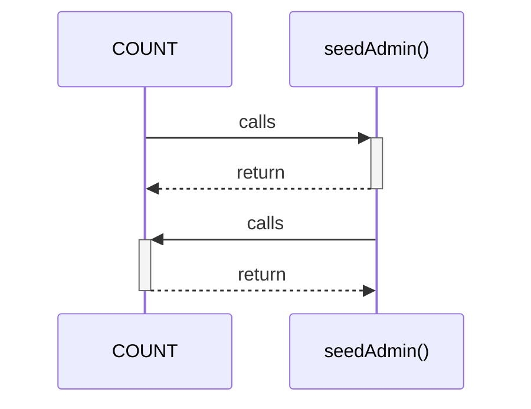

# COUNT

> God node · 2 connections · [C:\Users\Power\OneDrive\Desktop\projects\Flatmates\client\src\components\charts\TrendChart.tsx](file:///C:/Users/Power/OneDrive/Desktop/projects/Flatmates/client/src/components/charts/TrendChart.tsx#L44)

## Call Trace Diagram

## Connections by Relation

### calls
- [[seedAdmin()]] `INFERRED`

### contains
- [[TrendChart.tsx]] `EXTRACTED`

---

*Part of the graphify knowledge wiki. See [[index]] to navigate.*