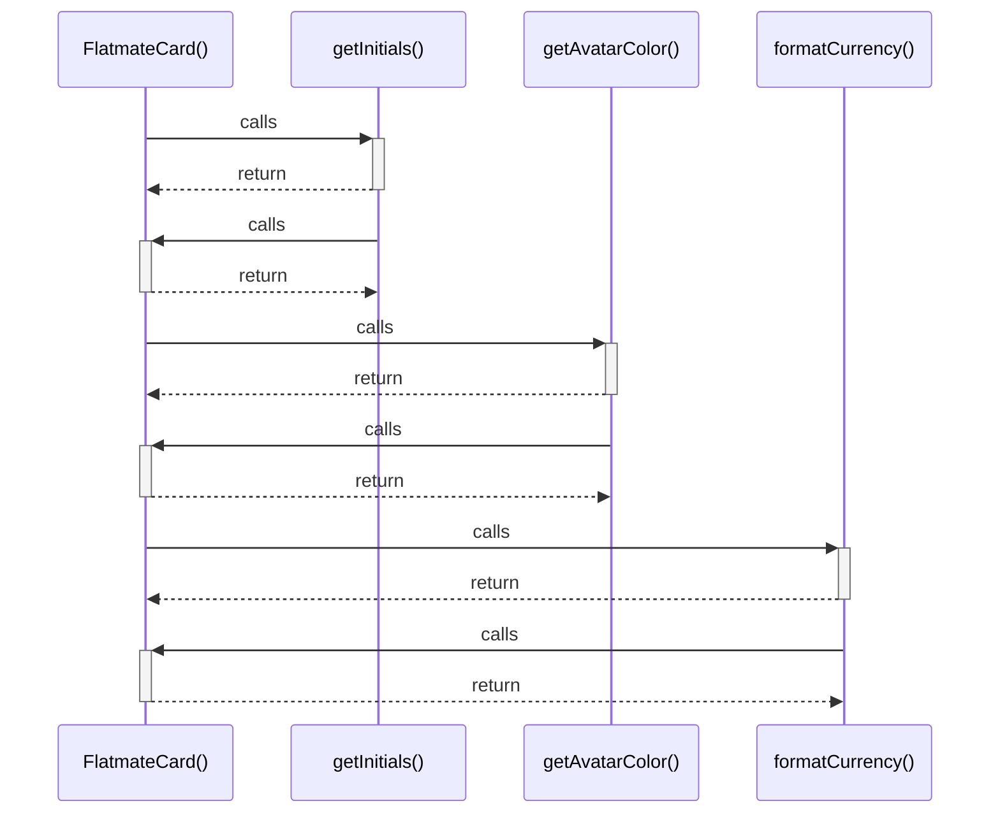

# FlatmateCard()

> God node · 4 connections · [C:\Users\Power\OneDrive\Desktop\projects\Flatmates\client\src\components\flatmates\FlatmateCard.tsx](file:///C:/Users/Power/OneDrive/Desktop/projects/Flatmates/client/src/components/flatmates/FlatmateCard.tsx#L10)

## Call Trace Diagram

## Connections by Relation

### calls
- [[getInitials()]] `INFERRED`
- [[getAvatarColor()]] `INFERRED`
- [[formatCurrency()]] `INFERRED`

### contains
- [[FlatmateCard.tsx]] `EXTRACTED`

---

*Part of the graphify knowledge wiki. See [[index]] to navigate.*