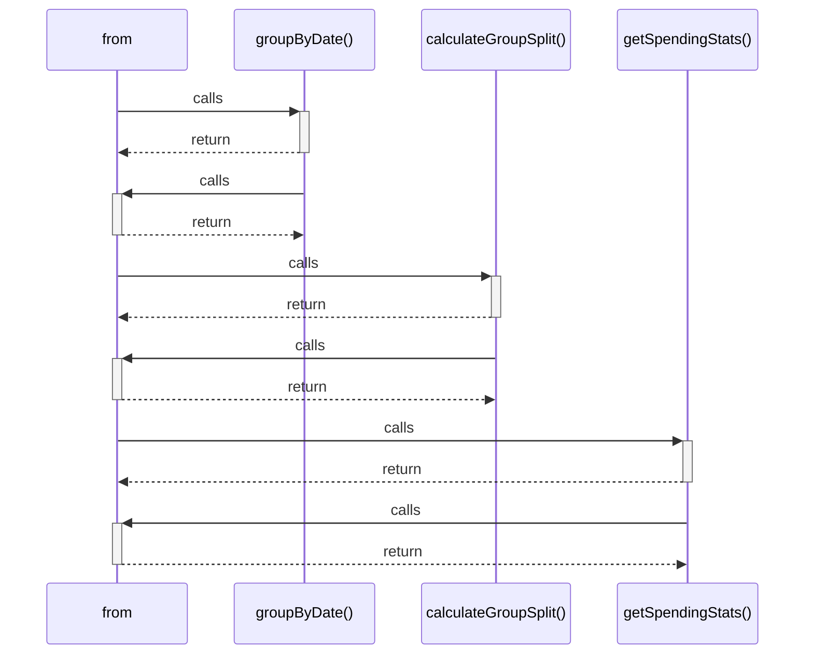

# from

> God node · 4 connections · [C:\Users\Power\OneDrive\Desktop\projects\Flatmates\client\src\pages\Login.tsx](file:///C:/Users/Power/OneDrive/Desktop/projects/Flatmates/client/src/pages/Login.tsx#L11)

## Call Trace Diagram

## Connections by Relation

### calls
- [[groupByDate()]] `INFERRED`
- [[calculateGroupSplit()]] `INFERRED`
- [[getSpendingStats()]] `INFERRED`

### contains
- [[Login.tsx]] `EXTRACTED`

---

*Part of the graphify knowledge wiki. See [[index]] to navigate.*