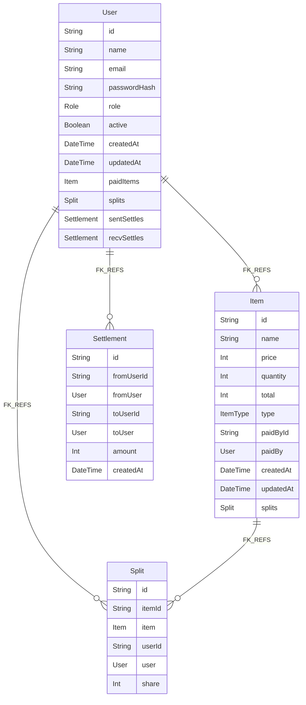

# Knowledge Graph Index

> Auto-generated by graphify. Start here — read community articles for context, then drill into god nodes for detail.

**318 nodes · 326 edges · 31 communities**

---

## System Architecture Flowchart

```mermaid
flowchart TD
    C0["User Authentication (46 nodes)"]
    C1["Community 1 (21 nodes)"]
    C2["Community 2 (21 nodes)"]
    C3["Community 3 (20 nodes)"]
    C4["Community 4 (20 nodes)"]
    C5["Community 5 (19 nodes)"]
    C6["Community 6 (17 nodes)"]
    C7["Community 7 (15 nodes)"]
    C8["Community 8 (15 nodes)"]
    C9["Community 9 (14 nodes)"]
    C10["Community 10 (13 nodes)"]
    C11["Community 11 (13 nodes)"]
    C12["Community 12 (12 nodes)"]
    C13["Community 13 (11 nodes)"]
    C14["Community 14 (10 nodes)"]
    C15["Community 15 (9 nodes)"]
    C16["Community 16 (7 nodes)"]
    C17["Community 17 (6 nodes)"]
    C18["Community 18 (4 nodes)"]
    C19["unknown (3 nodes)"]
    C20["Activation Status (3 nodes)"]
    C21["API Layer (2 nodes)"]
    C22["unknown (2 nodes)"]
    C23["Community 23 (2 nodes)"]
    C24["Community 24 (2 nodes)"]
    C25["Community 25 (2 nodes)"]
    C26["unknown (1 nodes)"]
    C27["unknown (1 nodes)"]
    C28["unknown (1 nodes)"]
    C29["unknown (1 nodes)"]
    C30["unknown (1 nodes)"]
    C0 -->|5 edges| C6
    C0 -->|3 edges| C9
    C0 -->|3 edges| C1
    C0 -->|3 edges| C13
    C10 -->|1 edges| C0
    C2 -->|1 edges| C1
    C0 -->|1 edges| C2
    C6 -->|1 edges| C9
    C6 -->|1 edges| C0
    C6 -->|1 edges| C1
    C6 -->|1 edges| C2
    C13 -->|1 edges| C8
    C1 -->|1 edges| C15
```

## Database Schema (ERD)

## Communities
(sorted by size, largest first)

- [[User Authentication]] — 46 nodes
- [[Community 1]] — 21 nodes
- [[Community 2]] — 21 nodes
- [[Community 3]] — 20 nodes
- [[Community 4]] — 20 nodes
- [[Community 5]] — 19 nodes
- [[Community 6]] — 17 nodes
- [[Community 7]] — 15 nodes
- [[Community 8]] — 15 nodes
- [[Community 9]] — 14 nodes
- [[Community 10]] — 13 nodes
- [[Community 11]] — 13 nodes
- [[Community 12]] — 12 nodes
- [[Community 13]] — 11 nodes
- [[Community 14]] — 10 nodes
- [[Community 15]] — 9 nodes
- [[Community 16]] — 7 nodes
- [[Community 17]] — 6 nodes
- [[Community 18]] — 4 nodes
- [[unknown]] — 3 nodes
- [[Activation Status]] — 3 nodes
- [[API Layer]] — 2 nodes
- [[unknown]] — 2 nodes
- [[Community 23]] — 2 nodes
- [[Community 24]] — 2 nodes
- [[Community 25]] — 2 nodes
- [[unknown]] — 1 nodes
- [[unknown]] — 1 nodes
- [[unknown]] — 1 nodes
- [[unknown]] — 1 nodes
- [[unknown]] — 1 nodes

## God Nodes
(most connected concepts — the load-bearing abstractions)

- [[FlatmateCard()]] — 4 connections
- [[from]] — 4 connections
- [[useAuth()]] — 3 connections
- [[app]] — 2 connections
- [[COUNT]] — 2 connections
- [[navigate]] — 2 connections
- [[handleLogout()]] — 2 connections
- [[ProtectedRoute()]] — 2 connections
- [[AdminRoute()]] — 2 connections
- [[validate()]] — 2 connections

---

*Generated by [graphify](https://github.com/safishamsi/graphify)*