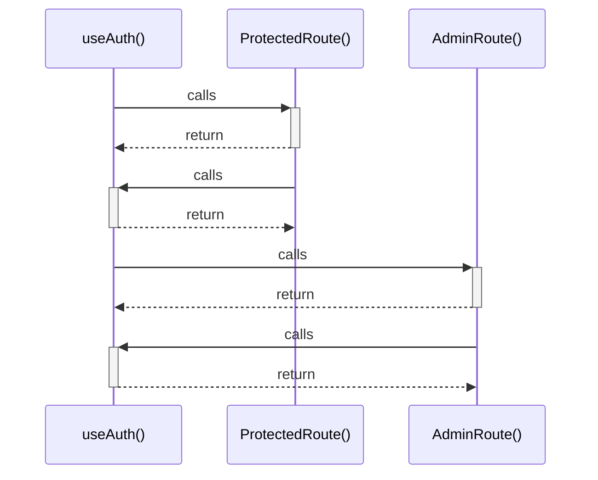

# useAuth()

> God node · 3 connections · [C:\Users\Power\OneDrive\Desktop\projects\Flatmates\client\src\context\AuthContext.tsx](file:///C:/Users/Power/OneDrive/Desktop/projects/Flatmates/client/src/context/AuthContext.tsx#L59)

## Call Trace Diagram

## Connections by Relation

### calls
- [[ProtectedRoute()]] `INFERRED`
- [[AdminRoute()]] `INFERRED`

### contains
- [[AuthContext.tsx]] `EXTRACTED`

---

*Part of the graphify knowledge wiki. See [[index]] to navigate.*