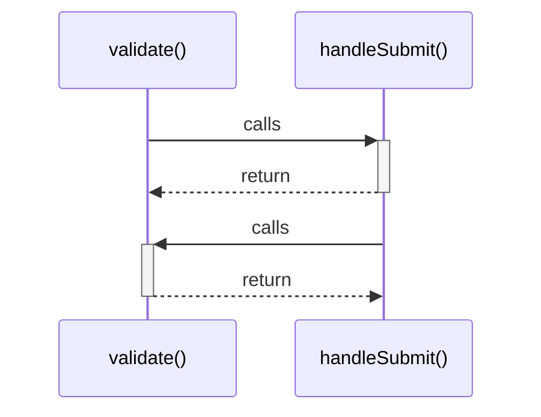

# validate()

> God node · 2 connections · [C:\Users\Power\OneDrive\Desktop\projects\Flatmates\client\src\pages\AddItem.tsx](file:///C:/Users/Power/OneDrive/Desktop/projects/Flatmates/client/src/pages/AddItem.tsx#L60)

## Call Trace Diagram

## Connections by Relation

### calls
- [[handleSubmit()]] `EXTRACTED`

### contains
- [[AddItem.tsx]] `EXTRACTED`

---

*Part of the graphify knowledge wiki. See [[index]] to navigate.*